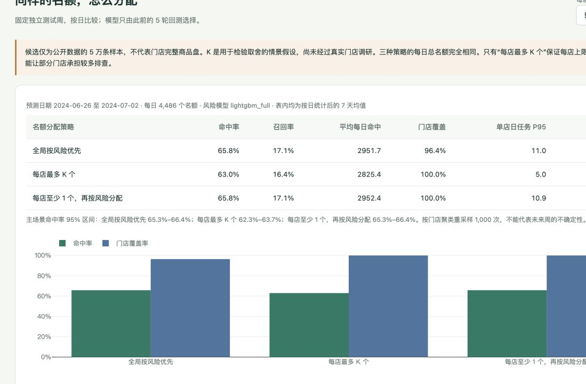

# 即时零售经营诊断与缺货排查策略分析

基于公开数据完成的开源复现与扩展，用于展示数据分析能力。**不是叮咚买菜内部项目或企业实习经历。**

## 业务问题

哪些门店、品类和时段缺货更严重？同样的每日排查名额，如何兼顾命中率、门店覆盖和工作负担？

## 实际运行结果

| 评估 | 结果 | 解释 |
|---|---|---|
| 数据与口径 | 485 万条商品日，898 家门店；7,760 万营业商品小时对账 | 观察窗口为 06:00–22:00，不含 22 点 |
| 原模型复现 | P@10%=65.14%，当天规则=57.56%；R@10%=18.86% | 属于开源预测方案复现，不能写成新增算法或实际缺货改善 |
| 新增 K=5 分配实验 | 同为 4,486 名额/日，覆盖由 96.44% 变为 100%；两策略命中率均约 65.8% | 命中率差区间跨 0，未证明提升或统计等效 |
| 验证 | 原 43 项与新增 11 项测试通过 | 容量、覆盖、标签独立性与时间顺序均有检查 |

[交互看板](docs/index.html) · [完整报告](docs/项目报告.md) · [代码归属](ATTRIBUTION.md)

看板可下载后直接用浏览器打开；GitHub 文件页本身不会执行 HTML。也可在 GitHub Pages 选择 main 分支的 /docs 目录作为展示入口。



## 新增工作

- 定义门店日、品类日、城市时段指标并核验分母，支持日期/城市筛选和门店下钻。
- 比较全局优先、每店上限与每店覆盖保底三种分配，保持每日总名额相同。
- 同时报告命中、召回、覆盖与单店负荷；保留全部场景和逐日结果，主场景做配对门店重采样。

原项目已有的预测模型、SQL 特征、时间回测与解释性分析保留原作者署名。详见 ATTRIBUTION.md。

## 复现

Python 3.12。创建 .venv 后安装 requirements-lock.txt。Apple Silicon 缺少 OpenMP 时可运行 setup_macos_runtime.py，只安装到本项目。

```bash
python run.py download
python run.py warehouse
python run.py checks
python run.py test
python run.py backtest
python run.py train
python run.py report
python run.py business
python run.py allocation
python run.py dashboard
```

数据与数据库需自行按命令生成。下载入口固定版本并验证哈希；不需要企业账号或付费模型接口。生成后的中文看板在 outputs/01_零售经营分析/。

## 关键限制

独立测试只有 7 天；公开样本不代表完整门店商品盘；每店容量没有真实人员调研。销量经缩放且缺少成本，不计算货币收益。没有真实干预，不能宣称缺货减少、收入提升或已上线。

## 来源

- 原代码：Jacob Willson，MIT，固定提交见 provenance.json。
- 数据：Dingdong-Inc/FreshRetailNet-50K，CC BY 4.0，详见 DATA_LICENSE.md。
